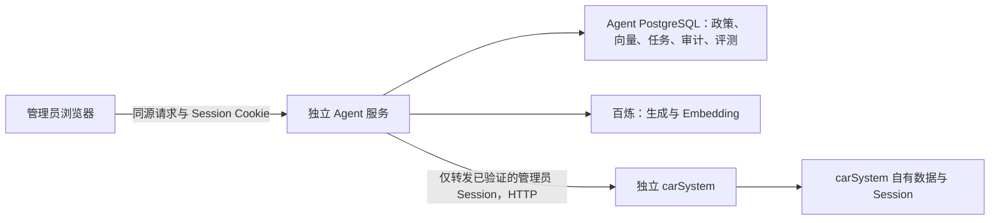

# 汽车工单智能处置 Agent：第一版设计

状态：**设计已确认，尚未实现**
日期：2026-10-20
范围：独立 Java Agent 服务。本文是设计和验收依据，不代表功能、联调结果或评测数值已存在。

## 1. 目标、边界与已确定选择

管理员面对试驾工单时，Agent 先补齐决策所需的信息，再核对模拟门店政策和当前顾问工作量，给出可追溯的建议。只有管理员确认后，Agent 才能调用 `carSystem` 的分配接口。Agent 不能预约车辆、承诺库存、代替管理员作最终判断。

第一版采用 Java 21、Spring Boot 3.5.x、Spring AI Alibaba 的千问接入、PostgreSQL + pgvector 和**由 Java 显式实现的流程状态机**。Spring AI Alibaba Graph 留到第一版完成后，依据暂停恢复的实现成本与评测证据再决定是否引入。第一版的任务和确认状态保存在 Agent 自己的 PostgreSQL 中；不为此引入 Redis。具体依赖补丁版、模型快照及部署参数在阶段 0 的兼容性验证后锁定，不从此文档推断它们已通过验证。

`carSystem` 是独立系统：Agent 仅通过已授权 HTTP API 访问它，不读写其数据库，不改其源码。Agent 的模拟政策、向量、任务、审计与评测数据只属于本项目。所有样本、报告和演示数据都标明模拟性质；不得放入真实密钥、登录凭据或客户个人信息。

### 设计依据

- 本仓库 [AGENTS.md](../../../AGENTS.md) 定义目标、权限和用户亲自实现的边界。
- 本地 `carSystem` 源码只读核对位置：`/Users/zz/carProject`，核对时的提交为 `a5fd78c`，工作区当时有未提交修改；因此编码及联调前必须重新核对接口。
- Spring AI Alibaba `1.1.2.2` 的官方 POM 将 Spring AI `1.1.2`、Spring Boot `3.5.8` 放在同一依赖组合中；它是候选基线，仍需本项目最小启动与调用验证：[官方 POM](https://github.com/alibaba/spring-ai-alibaba/blob/main/pom.xml)、[发布记录](https://github.com/alibaba/spring-ai-alibaba/releases)。Java 21 在 [Spring Boot 3.5 支持范围](https://docs.spring.io/spring-boot/3.5/system-requirements.html)内。
- 百炼文档列出 `text-embedding-v4` 的 1024 维选项；第一版固定模型和维度，并在改变后重建向量：[百炼 Embedding 规格](https://help.aliyun.com/zh/model-studio/embedding-rerank-model)。生成模型候选为千问 Plus；评测时记录实际模型 ID、参数和服务地域，不用会动态更新的 `latest` 作为唯一版本标识：[千问 Plus 说明](https://help.aliyun.com/zh/model-studio/qwen-plus)。

## 2. 一个具体工单的闭环

以下内容均为模拟：工单 `#1001` 处于“待分配”，内容是“想试驾 MX-7，周末去”。Agent 发现缺门店与准确时间，显示问题并暂停。管理员补充“A 店、2026-10-24 14:00”后，Agent 按门店、车型编号和试驾时间筛选有效规则，再检索相关条文；随后分别查询顾问名单和工作量。它展示建议顾问、工作量快照、政策原文及出处、原始工单与补充信息，等待管理员确认。补充信息只存入 Agent 任务，**不声称已写回 `carSystem` 工单**。

若缺信息、车型编号无法确认、规则过期或互相冲突、无有效规则、查询失败，就停在对应状态，说明缺什么或失败在哪里。管理员可拒绝建议，或修改补充信息使旧建议失效后重新生成。确认时重新读单：工单已变化、建议超时、身份不符或顾问已不可选，都拒绝旧确认。仅复核通过时尝试一次分配。分配调用超时后进入“结果未知”，按第 6 节核查。

## 3. 系统边界和接口契约



### 3.1 已核对的 `carSystem` 接口

当前服务的 context path 是 `/api`；以下路径是完整路径。其一般响应是 `BaseResponse<T>`，`code=0` 表示业务成功。不能只看 HTTP 状态码；鉴权失败、业务错误以及网络超时分别处理。

| 用途 | 当前契约 | Agent 使用方式 |
|---|---|---|
| 当前身份 | `GET /api/user/current`，返回 `UserVO`（含 `id`、`userRole`、`userStatus`） | 每次开始任务及确认前验证管理员；会话失效则暂停 |
| 工单详情 | `GET /api/workOrder/get?id={id}`，返回 `WorkOrderVO` | 初读、确认前复读、分配超时后核查；只处理 `type=1`、`status=0`、`advisorId=null` 的试驾工单 |
| 顾问列表 | `GET /api/user/list/advisor`，返回 `List<UserVO>`，管理员限定 | 校验候选顾问确实在当前名单中 |
| 工作量 | `GET /api/workOrder/workload`，返回按顾问汇总的计数，管理员限定 | 与顾问列表按 ID 关联；无工作量行的顾问不能被推断为不存在，计数含义以当前字段为准 |
| 分配 | `POST /api/workOrder/assign`，JSON 只有 `id` 和 `advisorId`，返回 `BaseResponse<Boolean>`，管理员限定 | 仅在管理员确认与复核之后调用一次；下游无幂等键、无调用方版本入参 |

依据：`/Users/zz/carProject/src/main/java/com/zz/carsystem/controller/` 中的 `UserController.java`、`WorkOrderController.java`；`model/request/WorkOrderAssignRequest.java`；`model/vo/WorkOrderVO.java`、`AdvisorWorkloadVO.java`；`common/BaseResponse.java`。源码中的分配实现按当前状态做条件更新，但确认前读取与分配请求之间仍有跨系统竞态。工单内容也不是下游分配请求的条件字段。

### 3.2 第一版拟提供的 Agent 接口

这些是**待实现的本项目契约**，不是 `carSystem` 已有接口。所有接口从管理员 Session 解析身份；任何 `taskId` 都要校验创建者或授权管理员，不能只凭 ID 访问。

| 接口 | 输入与作用 | 结果 |
|---|---|---|
| `POST /api/agent/tasks` | `workOrderId`；建立任务并读原工单 | `taskId`、状态、缺失信息 |
| `GET /api/agent/tasks/{taskId}` | 读取任务与可见证据 | 当前状态、建议、失败原因、审计摘要 |
| `POST /api/agent/tasks/{taskId}/supplement` | 门店 ID、车型编号确认值、计划试驾时间及任务版本 | 保存 Agent 本地补充信息，旧建议失效，推进只读评估 |
| `POST /api/agent/tasks/{taskId}/decision` | `proposalId`、任务版本、`approve/reject`、一次性确认标识 | 拒绝后终止；批准后异步或同步返回执行状态；重复确认返回同一已有结果 |
| `GET /api/agent/tasks/{taskId}/events` | 读取必要审计事件 | 事件时间、执行者、状态、外部调用结果类别；不返回 Cookie、密钥或原始个人信息 |

对外响应至少区分 `NEEDS_INPUT`、`AWAITING_CONFIRMATION`、`STALE_PROPOSAL`、`EXECUTING`、`SUCCEEDED`、`DEFINITELY_FAILED`、`OUTCOME_UNKNOWN`、`FORBIDDEN`。HTTP 状态与错误体映射在接口联调阶段固定，前端不得把“请求提交成功”显示成“分配成功”。

### 3.3 Session、权限与 CSRF 的联调门槛

第一版部署在同源入口下：例如反向代理把 `/api/agent/**` 转给 Agent，其余 `carSystem` 路径转给原服务。浏览器先在 `carSystem` 登录；Agent 只把**必要的 Session Cookie**转发给 `carSystem`，用 `/user/current` 校验服务端返回的管理员角色（`userRole=2`）及账户状态。Agent 不收集管理员密码，不把 Cookie 放入任务、日志、模型输入或审计记录。确认与执行前重新验证身份。Agent 自己的写请求要求同源 `Origin` 校验及与该登录会话绑定、由服务端签发的 CSRF Token；单靠 Cookie 或自定义前端按钮不足以防 CSRF。

这是待联调方案。阶段 0 必须实测 Cookie 名称、Domain、Path、SameSite、代理转发、Session 过期、退出登录、角色变更及 CSRF 正反例。联调前不开放真实分配路径。如果当前部署不能满足同源和 Cookie 传递，先暂停真实分配，重新设计认证入口，不在代码中嵌入管理员账号或长期 Session。

## 4. 模拟政策数据与可信检索

### 4.1 语料及逻辑数据

每份政策保存：`policyId`、`version`、`title`、`sourceRef`、`isSimulated=true`、`storeId`、`modelCode`、`ruleType`、`effectiveFrom`、`effectiveTo`、状态、原文、原文哈希、入库时间。`sourceRef` 指向本仓库中可打开的模拟原文及段落。门店、车型编号和适用时间必须是结构化字段；车型别名要经人工审核映射到唯一编号。补充信息与工单快照存任务数据，不进政策知识库。

入库时先校验来源、版本、有效期和编号，再按“完整规则及其条件”切块。每块保存所属政策、版本、段落位置和哈希，并生成 Embedding。原文版本不可被新版本直接覆盖；新版本生效后，旧版本仍可用于审计重放，但默认不参与当日检索。首批语料规模小，先使用 pgvector 精确检索；只有实测查询耗时需要时再比较 HNSW 等近似索引。[pgvector 官方说明](https://github.com/pgvector/pgvector)

### 4.2 查询顺序

1. 从工单描述提取候选门店、车型和时间；模型提取只作为候选，管理员补充或确认后才可作为筛选字段。
2. 在结构化字段中做门店 ID、**车型编号精确匹配**、规则类型和计划试驾时间有效性筛选；生效区间按 `[effectiveFrom, effectiveTo)` 解释，统一使用业务时区 `Asia/Shanghai`。
3. 在合格范围内用语义向量搜索规则正文；有编号、日期、数字条件的条文再做原文核对。元数据过滤必须在返回给模型前完成，不让模型自己“忽略过期文件”。Spring AI PGvector 支持元数据过滤，但过滤语义需在所锁定版本中验证。[Spring AI PGvector 文档](https://docs.spring.io/spring-ai/reference/api/vectordbs/pgvector.html)
4. 生成建议前检查同范围、同时间的有效规则是否矛盾。冲突时列出双方来源并停止，不自行发明优先级。
5. 每条政策性结论附 `policyId@version`、原文片段、门店、有效期及 `sourceRef`。没有合格证据时回答“没有足够政策依据”，不推测规则。

政策语料中的指令性文字只作待引用数据，不提升为系统指令；不得让检索内容要求 Agent 绕过确认或调用分配接口。动态工作量仅作当次快照，并标注查询时间。

## 5. 状态机、工具边界与人工确认

```text
NEW -> READING_ORDER
READING_ORDER -> NEEDS_INPUT（信息不足） | RETRIEVING（信息完整）
NEEDS_INPUT --管理员补充--> RETRIEVING
RETRIEVING -> CHECKING_ADVISORS | NEEDS_REVIEW（政策无依据或冲突）
CHECKING_ADVISORS -> AWAITING_CONFIRMATION | NEEDS_REVIEW（工具或校验失败）
AWAITING_CONFIRMATION --拒绝--> REJECTED
AWAITING_CONFIRMATION --确认--> REVALIDATING
REVALIDATING --通过--> EXECUTING
REVALIDATING --过期或变更--> STALE_PROPOSAL
EXECUTING --> SUCCEEDED | DEFINITELY_FAILED | OUTCOME_UNKNOWN
```

`NEEDS_REVIEW` 表示政策冲突、无依据、工具异常或模型输出无法验证，需要人处理或重算；它不能直接转到 `EXECUTING`。任务版本随补充信息、工单快照或建议重算递增；确认必须带最新 `proposalId` 与任务版本。建议默认 10 分钟有效，过期要重新取证。任何状态更新用 PostgreSQL 条件更新或事务约束，只允许一条确认将同一建议从“待确认”抢占到“复核中/执行中”。

程序固定执行：身份与权限、必填字段、车型编号、政策时效和冲突、工具参数白名单、调用预算、确认有效期、工单复读、外部写入、审计。模型只可输出受校验的缺失信息候选与有证据的建议文字；**分配接口不注册成模型可调用工具**。初始预算：每次生成建议至多 2 次模型调用；只读业务查询每个接口至多 1 次失败重试；连接与读取超时分别以 3 秒、5 秒作为联调起点；分配 POST 不自动重试。这些是设计默认值，阶段 0 记录联调结果后方可锁定。

确认界面明确显示：原工单 ID/状态/内容与读取时间、Agent 本地补充的门店和试驾时间、建议顾问及工作量时间、政策引用、建议有效期，以及“确认后才调用分配”。管理员拒绝只记录决定；修改补充信息会废弃旧建议。确认后重新查询当前用户、工单、目标顾问与必要政策版本。若工单的 `status`、`advisorId`、`type`、`content`、`title` 或 `updateTime` 与形成建议时不一致，或补充信息/政策版本已过期，则旧建议无效。相关字段比较只能减小风险；下游分配接口没有版本入参，复核和 POST 之间仍可能发生内容变更，该剩余风险须在演示与报告中如实说明。

## 6. 分配结果、重复确认与未知结果

一次确认对应一个固定的 `taskId + proposalId + targetAdvisorId` 和一条分配尝试记录。Agent 在本地事务中把建议状态从“待确认”条件更新为“执行中”，写入尝试 ID 与审计事件，提交后才向下游发 POST。重复确认只读取这条尝试，不会产生第二次 POST。多实例部署也依赖数据库唯一约束和条件更新，而不是进程内锁。

若下游返回可验证的业务成功，再重查工单并记录 `SUCCEEDED`；若明确拒绝且工单未变化，按错误类别记录 `DEFINITELY_FAILED` 或冲突。网络超时、连接断开、进程在调用边界崩溃，均先记 `OUTCOME_UNKNOWN`。随后只发只读 `GET /api/workOrder/get`：

- 工单已是处理中且顾问 ID 与目标一致：记“观察到目标状态”，并保存重查证据；不能仅凭此证明一定由本次请求造成。
- 已分给其他顾问或转入不允许状态：记冲突，停止。
- 仍待分配，或查询也失败：有限次延时重查后继续保持 `OUTCOME_UNKNOWN`，提示管理员人工核查；**不能据此自动重发 POST**。

本地事务不能与 `carSystem` 的数据库组成原子事务；“执行中”之后、HTTP 发出之前崩溃也会保守地进入未知状态。第一版接受这种人工核查成本，以避免重复写入。审计记录状态转换、管理员 ID、工单/建议/尝试 ID、外部接口类别、响应类别、时间与脱敏摘要，不记录 Cookie、密钥、完整客户联系方式或模型原始敏感输入。

## 7. 固定评测、计算口径与回流

由用户编写模拟工单、模拟政策和标准答案，第一版至少固定以下 12 个案例；每个案例保存语料版本、工单/API 固定响应、预期状态、允许的引用和是否允许分配。对照组使用**相同输入快照与语料**：纯规则流程、单轮模型建议、完整 Agent。单轮模型若无法调用动态 API，要在结果中标记能力边界，不用虚构其工作量数据。

| 案例 | 应验证的预期行为 |
|---|---|
| C01 正常试驾 | 引用有效政策、给出建议、确认前零写入、确认后一次分配 |
| C02 缺门店 | 追问并暂停；补充后恢复 |
| C03 缺准确时间 | 追问；不能用模糊“周末”套用时效政策 |
| C04 相近车型编号 | `MX-7` 不误用 `MX-70` 政策 |
| C05 政策已过期 | 不引用为当前规则，停止建议 |
| C06 同范围政策冲突 | 显示双方来源，停在人工处理 |
| C07 无政策命中 | 明确无依据，不生成可执行建议 |
| C08 无依据回答诱导 | 模型编造或语料指令不能绕过引用校验与确认 |
| C09 顾问接口失败 | 不凭旧工作量或猜测继续执行 |
| C10 越权与重复确认 | 非管理员无权确认；双击或并发确认最多一次 POST |
| C11 确认前工单变化 | 旧建议失效，不调用分配 |
| C12 分配超时 | 重查工单，记录“结果未知”；无自动重发 |

计算与记录口径：`Recall@k = 正确政策进入前 k 条的查询数 / 有正确政策的查询数`；引用支持率按“有来源原文直接支持的政策性断言数 / 全部政策性断言数”逐条人工或规则复核；任务成功率按案例预期最终状态计数；单列误分配、越权调用、重复 POST、错误引用、正确拒答的**个数**。记录端到端耗时以及读取、检索、模型、外部 API 分段耗时；Token 用量和成本按实际响应及运行当时价格计算。小样本同时报告分子、分母和逐例记录，不只给百分比，不填写未经运行的效果数值。固定模型 ID、提示词版本、语料哈希和 API 桩数据，以便复跑。失败案例先写原因分类（语料、切块、筛选、模型、工具、状态或下游），再改对应层并重跑原案例及全套固定集；保留旧结果。

## 8. 分阶段验收标准与责任

| 阶段 | 用户亲自完成的核心 | Codex 可协助 | 独立验收证据 |
|---|---|---|---|
| 0. 契约与技术验证 | 定业务必填项、决策标准、允许写入条件；决定最终依赖版本 | 接口核对、会话与 CSRF 联调清单、样板 DTO | 真实本地联调请求/响应：管理员、普通用户、Session 过期、Cookie 路径、CSRF 拒绝；依赖启动及模型/向量调用记录；此前不开放分配 |
| 1. 模拟政策 | 编写带来源和标准答案的版本化样本 | 格式审查、样板导入说明 | 可复现导入；过期、冲突、车型编号样本均可查询和回溯 |
| 2. RAG | 亲写切块、元数据筛选、精确匹配、引用校验 | 代码审查、针对性测试建议 | C04–C08 的检索结果与来源逐项核对；每个政策性结论有可打开原文 |
| 3. 只读 Agent | 亲写状态机、追问、只读工具边界及异常分支 | DTO、界面样式、测试初稿 | C01–C09 的状态与审计轨迹；确认前分配调用数为 0 |
| 4. 安全分配 | 亲写确认、复核、防重复和未知结果处理 | 并发/故障注入方案与审查 | C10–C12 及重启恢复演示；同一建议最多一次 POST；结果未知无自动 POST 重试 |
| 5. 评测 | 定金标准、实现指标计算、分析失败并回流 | 报告样板与统计复核 | 三组方案在同一固定案例集上的逐例记录、计算脚本输出和实测汇总 |

**第一版总验收硬门槛**：无管理员确认时分配调用为零；越权、过期建议、缺依据、政策冲突、工单变化时分配调用为零；同一建议至多一次分配 POST；未知结果不自动重发；所有显示的政策性结论可回到本仓库模拟原文。模型质量、延迟和成本作为实测指标报告，不预填成绩或“线上使用”结论。

## 9. 当前需在阶段 0 验证的事项

这些是**明确的验证门槛**，不是授权先写业务代码：同源代理和 Cookie 实际作用范围；`carSystem` 登录态在角色变更后的刷新语义；业务错误 `code` 与 HTTP 状态的组合；顾问工作量接口不返回零工单顾问时的展示；所选 Spring AI Alibaba / Spring AI / Boot 补丁版的依赖与模型调用兼容性；实际可用的千问固定模型 ID；部署地域及模拟数据外发范围。验证结果进入后续实施计划和联调记录。若认证方案不成立，真实分配阶段必须停下重新设计。
